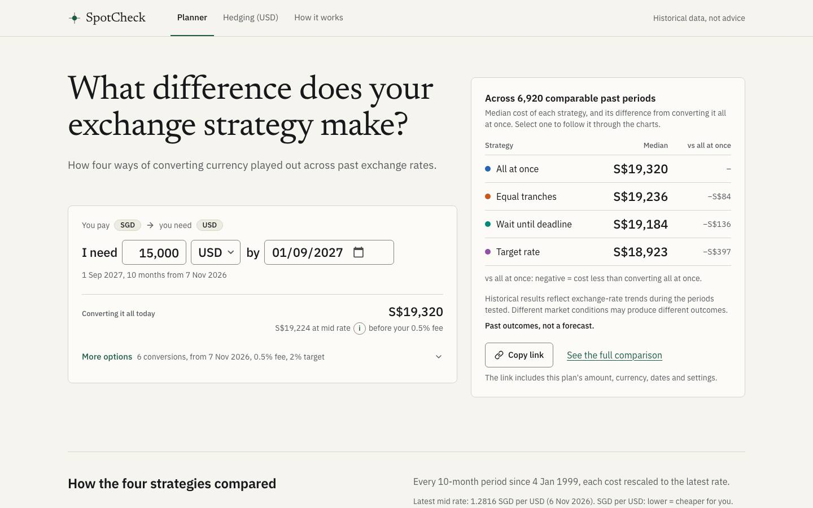
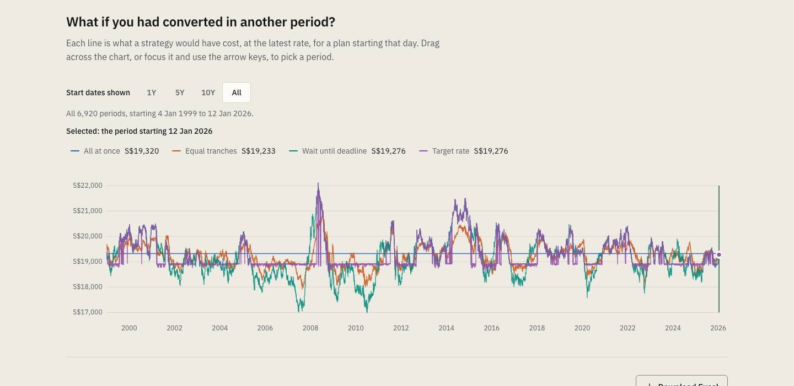
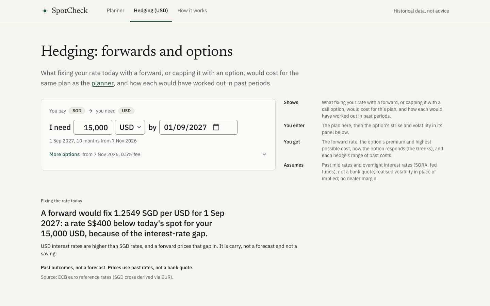

# SpotCheck

**A free web app that replays how different ways of converting SGD into a foreign currency would have played out, for students going on exchange.**

**Live:** https://spotcheck-fx.pages.dev

> Educational tool using historical mid-market rates. Not financial advice. Past rates don't predict future ones.



| Timeline of every past period                                                                                                                     | Hedging: USD forwards and options                                                                     |
| ------------------------------------------------------------------------------------------------------------------------------------------------- | ----------------------------------------------------------------------------------------------------- |
|  |  |

## What it does

- **Four strategies, replayed.** All at once, equal tranches, wait until the deadline, and a target rate with a deadline fallback, each run over every comparable past period since 1999 (about 6,900 periods for a 10-month plan). The result is the median, the middle 90% and the extremes for each.
- **40 currencies against SGD.** 36 go back to January 1999; BRL, CNY, ILS and INR go back to January 2000.
- **USD forward and option pricing.** Forwards by covered interest parity on SORA and fed funds. Call options by Garman-Kohlhagen, with a strike slider, payoff chart and Greeks. A historical comparison of unhedged, forward and option costs.
- **Shareable and auditable.** The whole scenario lives in the URL. No accounts, cookies or stored data. Any past period downloads as an `.xlsx` whose cost cells are live formulas.

## How it's built

```
Frankfurter / MAS / FRED → daily GitHub Actions job → validated JSON in data/ → static site → engine in a Web Worker
```

| Part            | Detail                                                                                                                                                                                    |
| --------------- | ----------------------------------------------------------------------------------------------------------------------------------------------------------------------------------------- |
| Front end       | Next.js 16 static export, TypeScript (strict), Tailwind CSS, Recharts. No server and no database.                                                                                         |
| Engine          | [`engine/`](engine) is pure TypeScript with no React, network, clock or randomness ([enforced by a test](engine/__tests__/purity.test.ts)). It runs in a Web Worker, off the main thread. |
| Data validation | Zod schemas plus sanity checks (date order, gaps, outsized moves, rate bounds) at fetch time and in CI. The browser parses every file through Zod too.                                    |
| Data pipeline   | A GitHub Actions job runs daily, writes nothing if any file fails validation, and commits new rates to `data/`. A nightly CI run then re-tests the site against them.                     |
| Hosting         | Cloudflare Pages, on free tiers only. The one secret (a FRED API key) stays in GitHub Actions.                                                                                            |

Rates come from the [ECB euro reference rates](https://www.ecb.europa.eu/stats/policy_and_exchange_rates/euro_reference_exchange_rates/html/index.en.html) and central-bank mid rates via [Frankfurter](https://frankfurter.dev/), [MAS](https://eservices.mas.gov.sg/Statistics/dir/DomesticInterestRates.aspx) (SORA) and [FRED](https://fred.stlouisfed.org/series/DFF) (fed funds, Board of Governors of the Federal Reserve System).

## How it's tested

| What                                 | How                                                                                                                                                                                                                                           |
| ------------------------------------ | --------------------------------------------------------------------------------------------------------------------------------------------------------------------------------------------------------------------------------------------- |
| Unit tests                           | 577 Vitest tests. Engine coverage above 99% of statements (90% enforced).                                                                                                                                                                     |
| End-to-end                           | 828 Playwright cases over phone, desktop, a German locale and a Los Angeles time zone. 717 run and pass; the other 111 need a mouse, keyboard or touch screen that configuration lacks, or cover one configuration only.                      |
| Accessibility                        | axe-core (WCAG A/AA) on every page, in light and dark, at phone and desktop widths: 0 violations. Run by hand, not in CI.                                                                                                                     |
| Independent re-implementation parity | [`notebooks/crosscheck.ipynb`](notebooks/crosscheck.ipynb) re-implements compounding, the strategies and option pricing in Python and writes fixtures. The TypeScript engine matches them to 1e-12 on compounding and 1e-9 on strategy costs. |
| Published-figure check               | The compounding reproduces every compounded SORA value MAS has published since August 2020 (over 4,000) to within about 0.01 bp, which is MAS's own rounding.                                                                                 |
| Advisory-wording safeguards          | [A list of banned patterns](tests/advisory-patterns.ts) runs over generated sentences and every rendered page, so advice or verdict wording fails the tests.                                                                                  |
| Security                             | A strict [Content-Security-Policy](public/_headers) and related headers, a gitleaks secret scan in CI, and GitHub Actions pinned to commit SHAs.                                                                                              |

Counts as of November 2026.

## Limitations

- **Historical, not a forecast.** It shows what past periods would have cost, rescaled to the latest rate. It says nothing about what rates will do next.
- **Mid-market rates.** Real bank and money-changer rates add a spread on top. The planner adds a fee you enter; hedging prices use past rates and realised volatility, with no dealer margin, so they aren't quotes. Twelve currencies come from blended mid rates, whose daily volatility may be understated.
- **USD-only hedging.** Forwards and options price USD against SGD. Other currencies can be replayed on the planner only.

## More

[How it works](https://spotcheck-fx.pages.dev/how-it-works) (the method in plain terms) · [Case study](docs/case-study.md) · [Design system](DESIGN.md)

Run it locally with Node.js 24.2+: `npm ci`, then `npm run dev`. `npm run check` runs the type-check, lint, unit tests and data validation.
