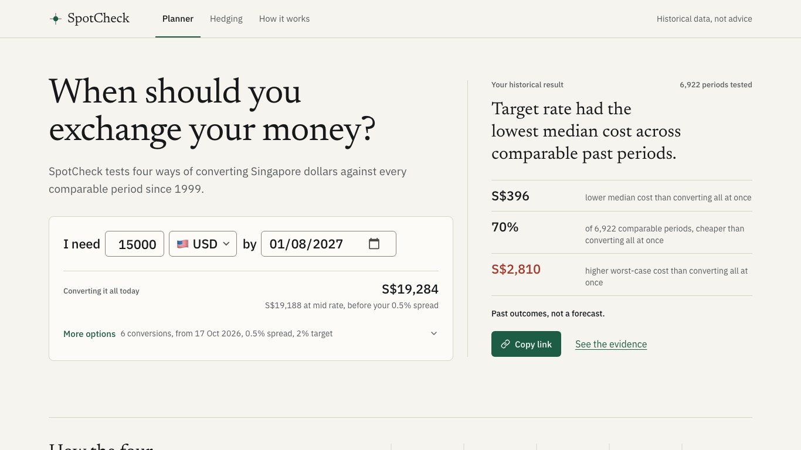

# SpotCheck

**See how converting your exchange money would have played out.**

SpotCheck is a free web app for students going on exchange who need a lump of foreign currency by a known date (say USD 15,000 for a US semester starting August 2027). It replays four simple ways of converting SGD over every comparable period since 1999 and shows the range of outcomes. A hedging tab prices forwards and options with interest-rate parity and Garman-Kohlhagen.

> **Live site:** `LIVE_SITE_URL` _(placeholder: replaced with the Cloudflare Pages URL once it is connected)_
>
> Educational tool using historical mid-market rates. Not financial advice. Past rates don't predict future ones.



## What it does

- **Planner.** Pick a currency (40 used by NUS, NTU and SMU exchange destinations), amount, start date, deadline, number of conversions and your bank's spread. SpotCheck runs four strategies (all at once, equal tranches, wait until the deadline, target rate with a deadline fallback) over every historical window that starts on a trading day (about 7,000 for a 9-month plan) and shows the median, middle 90% and extremes, plus a plain-English summary and a slider to inspect any single window.
- **Hedging tab.** Today's forward (spot, forward points, the SORA and fed-funds rates behind it), an option pricer with a strike slider, payoff chart and live Greeks, and a historical comparison of unhedged vs forward vs option.
- **Shareable.** The whole scenario lives in the URL. No accounts, no cookies, no data stored.
- **Auditable.** Download any historical window as an `.xlsx` whose cost cells are live formulas.

## How the engine works

Everything is in [`engine/`](engine): pure TypeScript with no React, network, clock or randomness (a test enforces this). FX is always SGD per 1 foreign unit; rates are decimals; time is ACT/365.

**Strategies.** Each conversion costs `units × rate × (1 + spread)` at the first available rate on or after its date. Equal tranches are spaced evenly in calendar days, start to deadline inclusive. The target strategy converts the first day the rate is at or below the target, otherwise on the deadline.

**Historical replay.** For every start date _d_ with a full window after it, run every strategy from _d_ to _d + L_. To compare a 1999 window (1.70 SGD/USD) with a 2024 one (1.34), each window's cost is divided by its own starting spot, then multiplied by today's spot and the user's amount: _"if the coming months move the way that window did, this is what you'd pay."_

**Compounded SORA** (the MAS method), with _rᵢ_ the rate for business day _i_, _nᵢ_ the days it applies and _N_ the window length:

```
r = ( Π (1 + rᵢ·nᵢ / 365) − 1 ) × 365 / N
```

**Forwards** (covered interest parity, simple interest):

```
F = S₀ × (1 + r_SGD·T) / (1 + r_USD·T)
```

with _r_ the overnight rate compounded over the tenor-length window ending on the pricing date (SORA for SGD; fed funds, ACT/360, for USD).

**Options** (Garman-Kohlhagen call on the foreign currency, continuously compounded rates):

```
C  = S₀·e^(−r_f·T)·N(d₁) − K·e^(−r_d·T)·N(d₂)
d₁ = [ ln(S₀/K) + (r_d − r_f + σ²/2)·T ] / (σ√T),   d₂ = d₁ − σ√T
```

σ is the realised volatility of log returns between consecutive trading observations over the 250 (or 60/90) trading days **before** the pricing date, annualised with √252 (user-overridable). The normal CDF is Hart's double-precision approximation.

**No look-ahead.** Decisions on day _d_ only see data up to _d_: `rateAsOf` for decisions, `rateOn` for trades, volatility and rates from before _d_. Tests alter every value after _d_ and assert nothing decided by _d_ changes.

## Testing

| What                    | How                                                                                                                                                                   |
| ----------------------- | --------------------------------------------------------------------------------------------------------------------------------------------------------------------- |
| Unit tests (150+)       | Vitest; engine coverage ~99% (90% enforced)                                                                                                                           |
| MAS back-check          | Our compounding reproduces **all 4,600+ compounded SORA values MAS has published since Aug 2020** within 0.0101 bp                                                    |
| Independent cross-check | [`notebooks/crosscheck.ipynb`](notebooks/crosscheck.ipynb) reimplements compounding, strategies and GK (scipy) and writes fixtures; TS matches to 1e-12 / 1e-9 / 1e-6 |
| Pricing properties      | Put-call parity (1e-10), monotonic in σ and S, delta bounds, Greeks vs finite differences, textbook reference C = 0.07505                                             |
| Data validation         | Zod schemas + sanity checks (ascending dates, gaps, ±30% moves, rate bounds) on every file, in CI and in the browser                                                  |
| End-to-end              | Playwright on mobile and desktop: planner, hedging tab, URL round-trip, xlsx download                                                                                 |
| Lighthouse (mobile)     | Performance 94–96, accessibility 100, best practices 100, SEO 100                                                                                                     |

```bash
npm install
npm run check      # type-check, lint, unit tests + coverage, data validation
npm run build      # static export to out/
npm run e2e        # Playwright against out/
npm run fetch-data # refresh data (FRED_API_KEY optional)
```

Requires Node.js 24.2 or later.

## Architecture

A daily GitHub Actions job fetches new data, validates it, and commits JSON files to `data/`. The site is a Next.js static export on Cloudflare Pages; the browser loads one currency's history (~70 KB gzipped) and runs the engine in a Web Worker. There is no server, no database and no secret outside GitHub Actions.

```
Frankfurter / MAS / FRED → scripts/fetch (daily, validated) → data/*.json → static site → engine in the browser
```

## Data sources

- Exchange rates, one source per currency for its whole history:
  - 27 currencies (USD, EUR, GBP, JPY, AUD, CNY, INR and others the ECB has published every working day since 1999, or since 13 Jan 2000 for BRL, CNY, ILS and INR): [European Central Bank euro foreign exchange reference rates](https://www.ecb.europa.eu/stats/policy_and_exchange_rates/euro_reference_exchange_rates/html/index.en.html), retrieved via [Frankfurter](https://frankfurter.dev/). **SGD crosses are derived by SpotCheck as (SGD per EUR) ÷ (currency per EUR).**
  - The other 12 (ARS, CLP, COP, ISK, KZT, MAD, MOP, PEN, RUB, SAR, TWD, VND): [Frankfurter](https://frankfurter.dev/) blended central-bank mid rates (daily volatility from these may be understated).
- SGD interest rates: [MAS Domestic Interest Rates](https://eservices.mas.gov.sg/Statistics/dir/DomesticInterestRates.aspx), daily SORA from July 2005 and published compounded SORA.
- USD interest rates: Board of Governors of the Federal Reserve System, Federal Funds Effective Rate (DFF), retrieved from [FRED](https://fred.stlouisfed.org/series/DFF), Federal Reserve Bank of St. Louis.

## Project docs

- [`SPOTCHECK_PLAN.md`](SPOTCHECK_PLAN.md): the build plan · [`CLAUDE.md`](CLAUDE.md): project rules
- [`docs/phases/`](docs/phases): what was built in each phase, with test results and decisions
- [`docs/case-study.md`](docs/case-study.md): the write-up

Built with Next.js, TypeScript, Tailwind CSS, shadcn/ui, Recharts, Zod, ExcelJS, Vitest and Playwright.
