# PR A: correctness and robustness fixes from the stress test

Ten testers stress-tested the production build. This round fixes their correctness and robustness findings (A1–A10) and reports on three data anomalies (A11). Accessibility, performance and hardening (B1–B6) come in PR B.

`before/` is a build of `main` at `f00eedb` and `after/` is this branch, same data, 1366px wide. Every fix has a test that fails on the `before` build and passes now: `e2e/robustness.spec.ts`, with unit tests in `lib/__tests__/`.

## A1. Start dates outside the data

**Before:** `/?c=USD&a=15000&s=1999-01-01&d=1999-08-01` replaced the whole app with "This page couldn't load", with no header or disclaimer. So did CNY/BRL/INR/ILS before 13 Jan 2000, Hedging before SORA's look-back, a start in 2060, and Hedging after the planner at `s=2004-01-05`.

**After:**

- **Checked before pricing:** the start date is checked against the currency's data and, on Hedging, against the SORA and fed funds look-back. Any problem appears under the start field with a specific message, e.g. "USD data starts 4 Jan 1999. Pick a start on or after that date."
- **One-click fix:** the planner offers "Start on 4 Jan 1999 instead", or "Start today instead" for a far-future start.
- **Limits:** starts are capped at a year from today. Hedging refuses a forward more than 3 years from the latest rates.
- **Date pickers:** they now carry `min` and `max`.
- **Error boundary:** `app/error.tsx` keeps the header, nav and disclaimer for any other error, with a link to the default plan.

| Before                               | After                               |
| ------------------------------------ | ----------------------------------- |
|  | 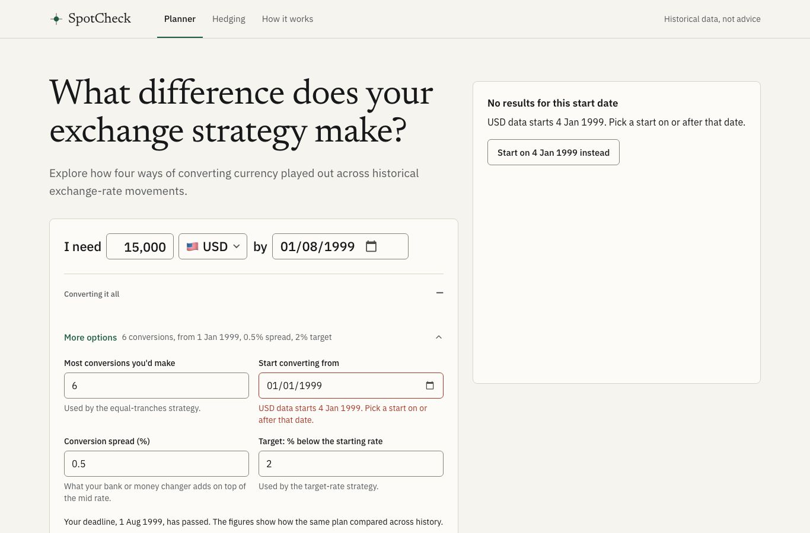 |
|       | 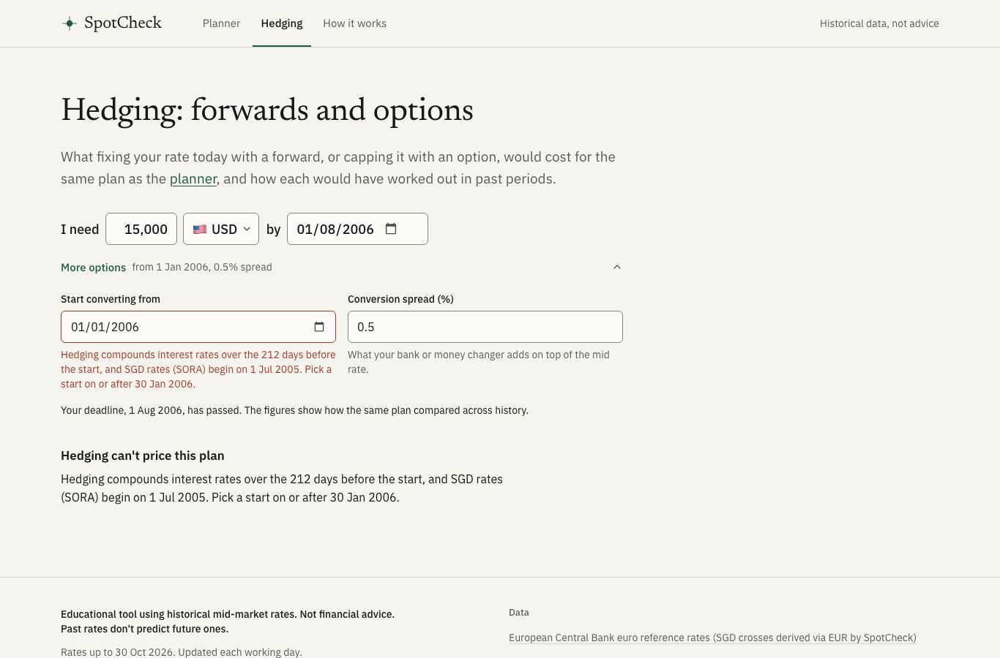      |

## A2. "Today" and "latest" for a start that isn't today

**Before:** `s=2025-01-02` showed "Converting it all today", "Latest mid rate: 1.3653 (2 Jan 2025)" and "known today". A future start also said "known today", and a past deadline had no notice.

**After:** the wording follows the start date (`lib/start-context.ts`):

- **Past start:** "Converting it all on 2 Jan 2025", "Mid rate on 2 Jan 2025: 1.3653 SGD per USD.", "known on that day", "rescaled to the rate on 2 Jan 2025".
- **Future start:** "at the latest rate", and "The rate on 1 Mar 2027 isn't known yet."
- **Past deadline:** "Your deadline, 1 Aug 2025, has passed."
- **Hedging:** says "below the spot on 2 Jan 2025", "Fixing the rate on 2 Jan 2025", and labels the payoff chart's spot line with the date.

"Today" appears only when the plan starts on the newest rate.

| Before                        | After                        |
| ----------------------------- | ---------------------------- |
| 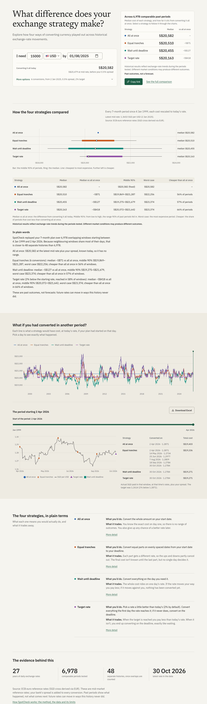 | 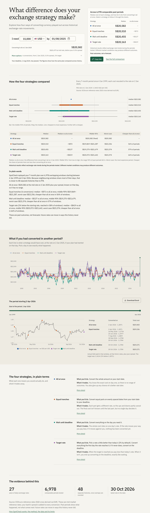 |

## A3. European number formats

**Before:** with `type="number"`, "15.000" became 15, "1.500,50" became 1.5005, "15,5" became 155, a spread of "0,5" became 5%, and Arabic-Indic digits emptied the field.

**After:** these are text inputs with `inputMode="decimal"` and a strict parser (`lib/number-input.ts`).

- **Accepted:** plain digits, one decimal point, and commas or spaces between groups of three.
- **Ambiguous forms:** each gets its own message instead of a guess: "Write thousands without dots, e.g. 15000 or 15,000.", "Use a dot for decimals, e.g. 0.5.", "Use the digits 0–9."
- **Echo:** while you type, the amount is read back, e.g. "= EUR 250,000".
- **Display:** the amount now shows with grouping ("15,000").
- **Tests:** unit tests, plus a de-DE browser context.

| Before                              | After                              |
| ----------------------------------- | ---------------------------------- |
| 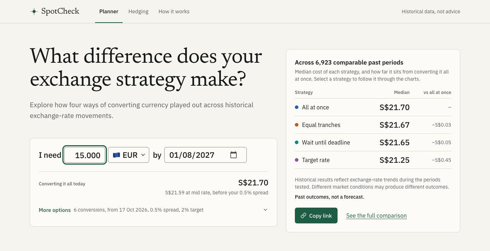 | 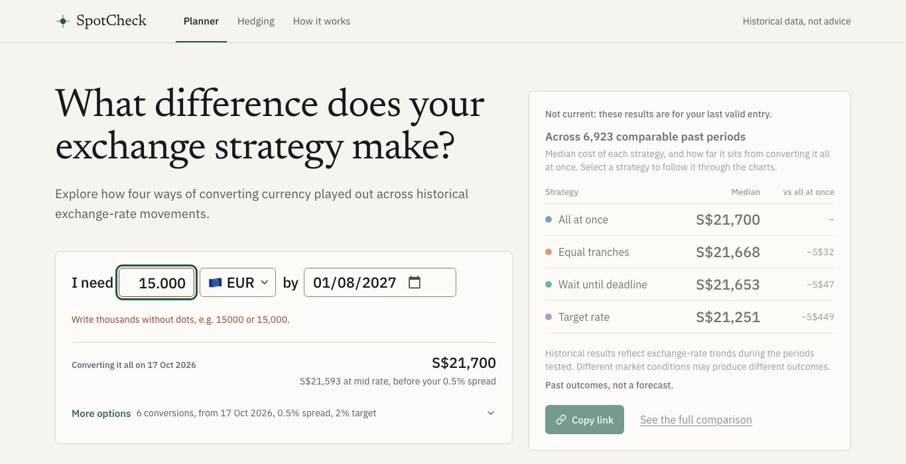 |

## A4. Partial values while typing

**Before:** typing "15" in Spread committed `sp=1`, "36" committed `k=3`, "1000" committed `t=10`. Volatility "101" became 10 silently, and 0, −5, 0.5 and abc vanished.

**After:**

- **Committing:** a number is used only once the whole entry is valid and typing has paused (400 ms), or the field loses focus.
- **Errors:** they state the real limits: "Enter 0–5%.", "Enter 1–100%, or leave it empty for realised volatility.", "Enter an amount from 1 to 1,000,000,000,000."
- **Not current:** while a field is invalid, the old results dim and say "Not current".
- **Start-date errors:** they sit under the start field.
- **Mouse wheel:** the text inputs ignore it.

| Before                       | After                       |
| ---------------------------- | --------------------------- |
| 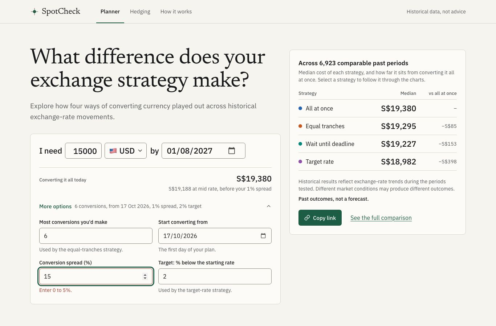 | 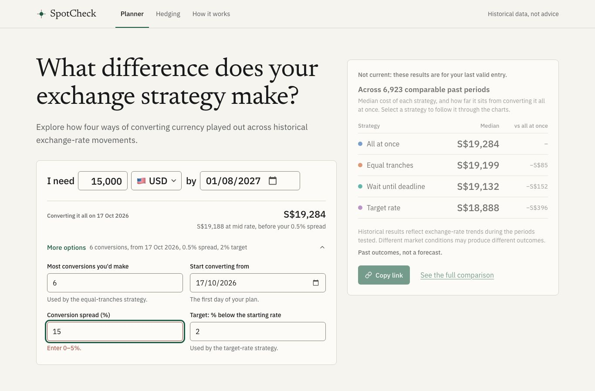 |
| 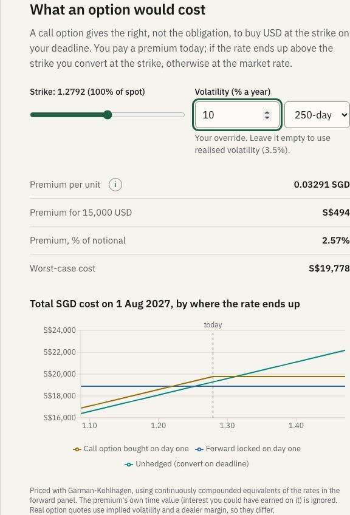   | 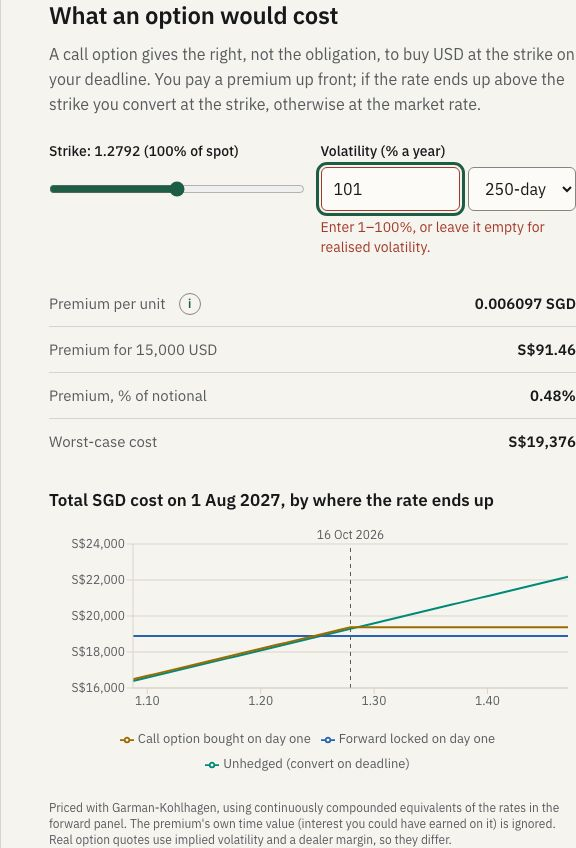   |

## A5. Navigation loses the scenario

**Before:** the tabs read `useSearchParams()`, which doesn't see `history.replaceState`, so they linked to the page-load query (or none). How it works, "Back to the planner" and the Hedging intro's link dropped the query entirely.

**After:** one shared source (`lib/scenario-link.ts`) updates on every edit, not after the URL's 300 ms pause. Every internal link carries the full scenario, explicit start and deadline included even from a bare `/`: the tabs, the wordmark, How it works, "Back to the planner" and the Hedging intro.

## A6. Copy link

**Before:** it copied `location.href`, so during the 300 ms debounce it got the old amount. From an untouched page it copied a bare `/`.

**After:** the link is built from the scenario on screen and names every setting (`c a s d k sp t ks vl`, plus `v` when set). The recipient sees exactly the same plan, whatever their "today".

## A7. BND (1:1 peg)

**Before:** the timeline was blank, with 8 `NaN` path errors. The plain words said "S$15,075–S$15,075". Hedging said it "needs BND interest-rate history".

**After:**

- **Timeline:** a flat range gets a small band, so nothing divides by zero. I checked the other charts too; they already used `niceTicks`, which pads a flat range.
- **Plain words:** "S$15,075 (fixed)", like the table.
- **Hedging:** "The Brunei dollar is pegged 1:1 to the Singapore dollar, so there is no exchange rate to hedge…".
- **Peg precision:** the target reads "0.9800" (was "0.98000").

| Before                          | After                          |
| ------------------------------- | ------------------------------ |
| 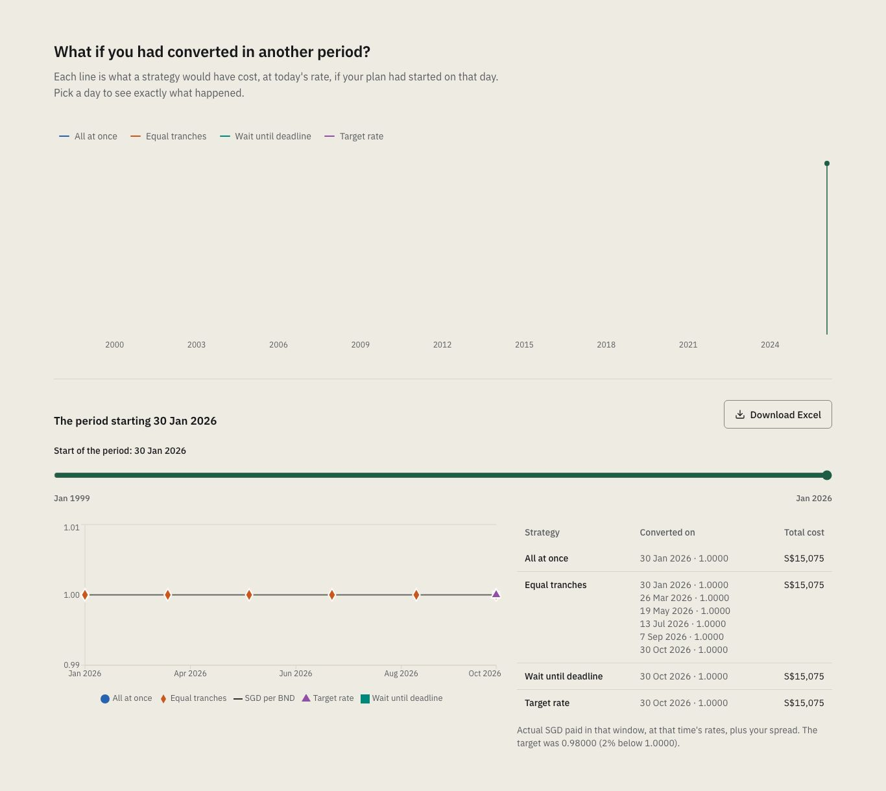 | 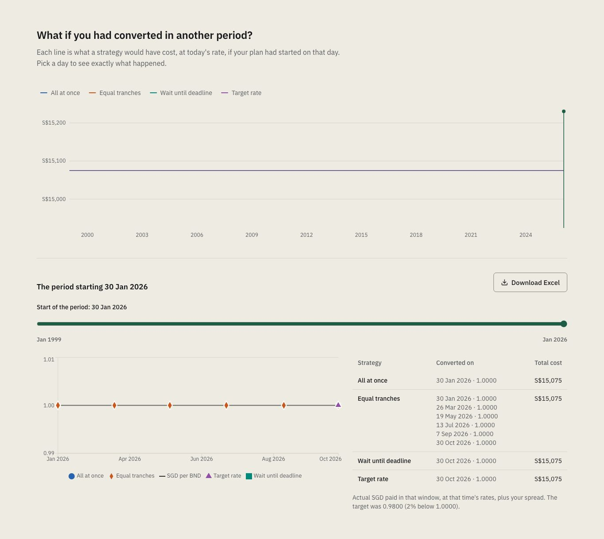 |
| 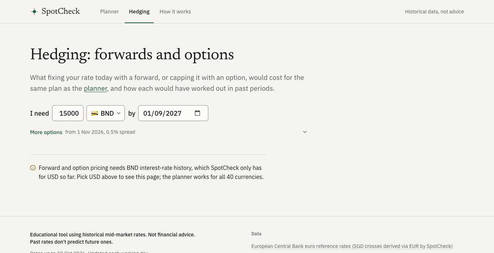  | 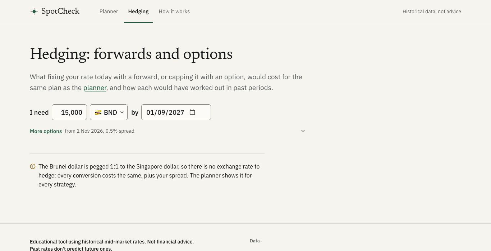  |

## A8. Data that doesn't load

**Before:** "Loading the rate history…" and skeletons stayed forever. The alert showed raw internals ("Failed to fetch", JSON positions, a Zod dump). There was no timeout and no retry.

**After:**

- **Message:** "Couldn't load the USD rate history. Check your connection and try again.", with a **Try again** button.
- **Timeout:** 20 s, which ends in "…took too long to load".
- **Details:** they go to the console only.
- **Tested:** abort, HTTP 500, bad JSON, wrong shape and a hang (driven by Playwright's clock).

| Before                        | After                        |
| ----------------------------- | ---------------------------- |
| 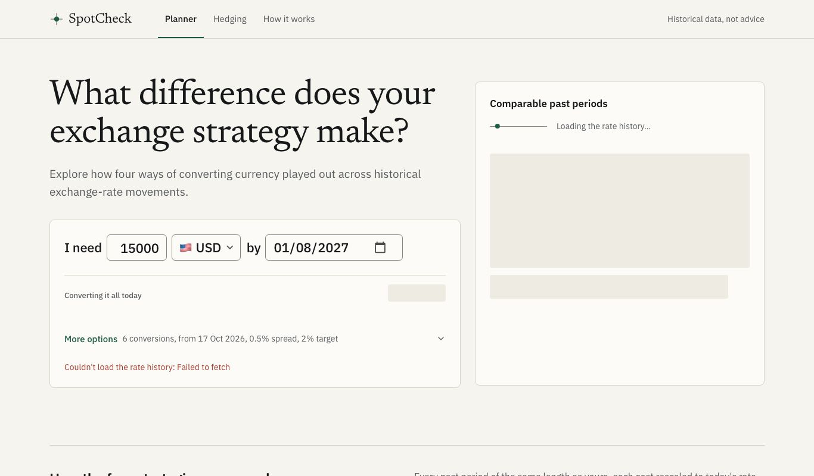 | 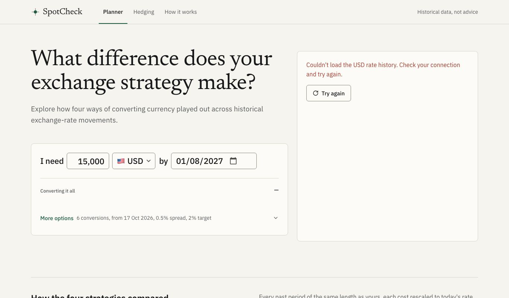 |

## A9. Plan length edge cases

- **Short plans:** a 7–14 day plan reads "14-day", not "0-month".
- **Conversions:** they are capped so they never land on the same trading day: at least 3 calendar days apart, so a 14-day plan holds up to 5. This is stricter than "the number of trading days". Even spacing with fewer than 3 days between dates can put a Saturday and a Sunday on the same Monday. A unit test checks every start weekday and every length from 1 to 10 weeks.
  - **When a plan shortens:** a lower count shows "Lowered to 5: conversions are at least 3 days apart."
  - **From a link:** `k=24` on a 14-day plan falls back to 5.
- **Three years:** an exact 3-year plan across a leap year (1,096 days) is allowed. The rule is now "within 36 calendar months", not 1,095 days.
- **URL values:** `k=1.5` and `ks=95.5` fall back to the defaults, as the form would, instead of being rounded.

| Before                           | After                           |
| -------------------------------- | ------------------------------- |
| 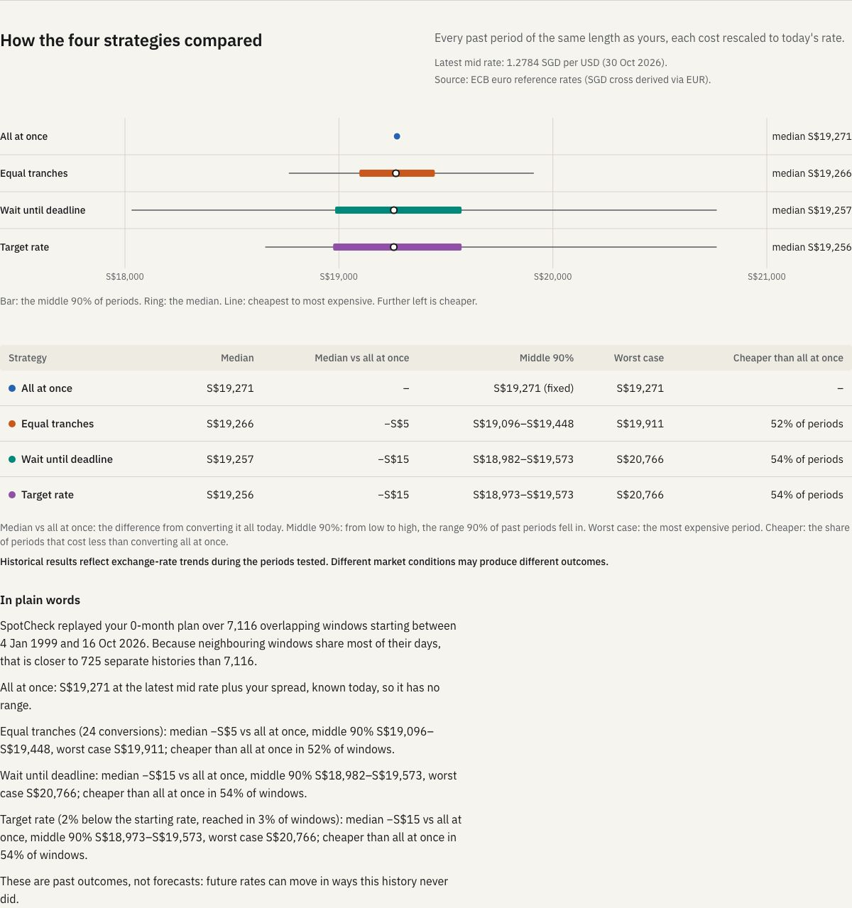 | 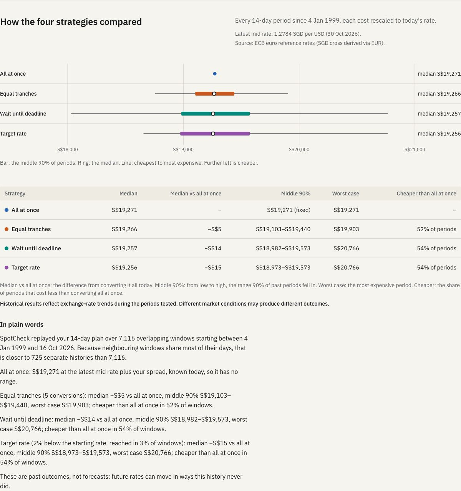 |

## A10. Number formatting

- **Differences:** they come from the rounded figures shown beside them, so medians of S$121 and S$122 read "−S$1", never "S$0". This applies to the glance panel, the table, the timeline tooltip and the plain words.
- **Separators:** "closer to 1,451 separate histories".
- **Forward points:** U+2212 in both places, "−258.1 pips (−0.02581)".
- **Premium per unit:** "<0.000001 SGD", not "2.250e-10 SGD".
- **Carry:** the forward panel uses the headline's precision: whole dollars for a plan of S$100 or more, so the two never read "S$44" and "S$43.68".
- **Help tips:** titled "About forward points" (was "What is forward points?"). DESIGN.md is updated to match.
- **Volatility:** "from 250 daily changes, 5 Nov 2025–29 Oct 2026".
- **BND target:** "0.9800".

| Before                            | After                            |
| --------------------------------- | -------------------------------- |
| 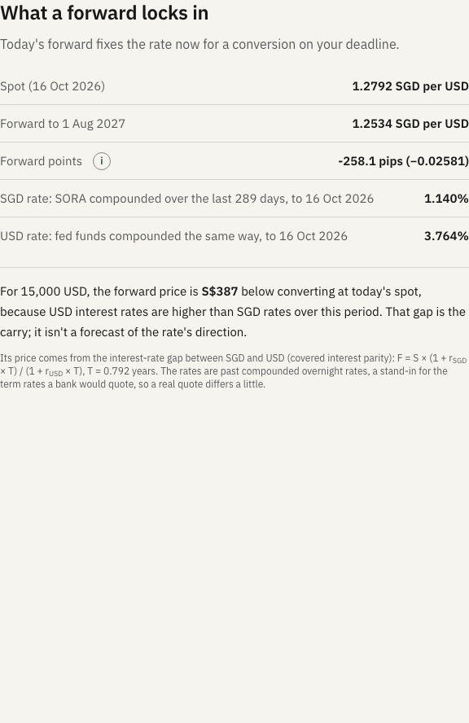 | 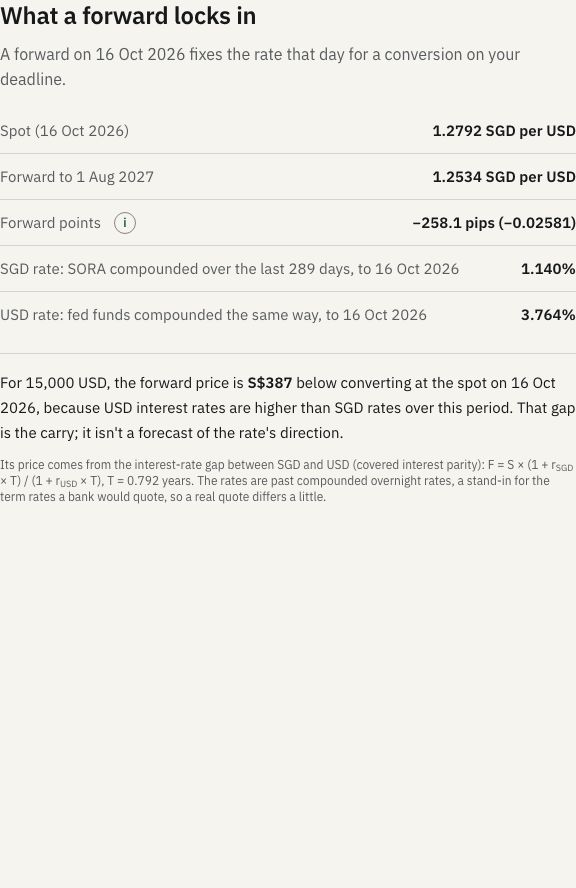 |
| 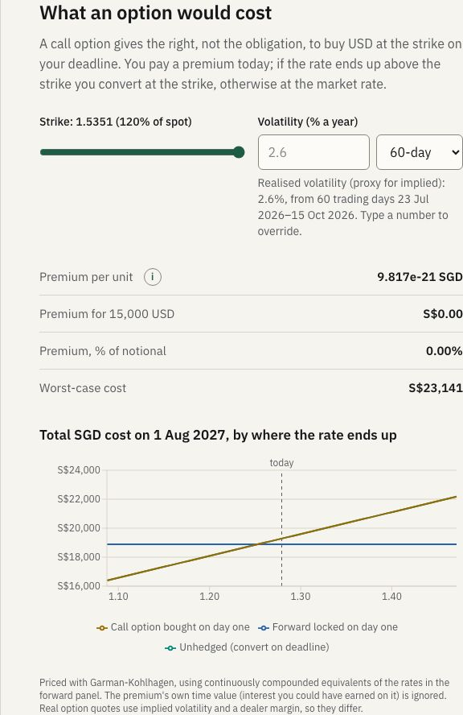   | 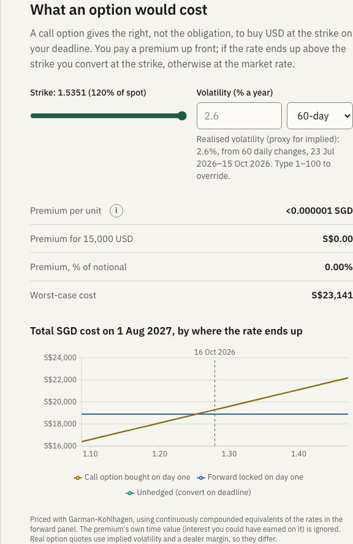   |

## A11. Data anomalies (investigated, nothing changed)

| Anomaly                                    | Upstream check                                                                                                                                                               | Finding                                                                       | Proposal (needs approval)                                                                                                                                                                                                                                                                                                                                                                                                                               |
| ------------------------------------------ | ---------------------------------------------------------------------------------------------------------------------------------------------------------------------------- | ----------------------------------------------------------------------------- | ------------------------------------------------------------------------------------------------------------------------------------------------------------------------------------------------------------------------------------------------------------------------------------------------------------------------------------------------------------------------------------------------------------------------------------------------------- |
| BRL 11 Feb 2000, −13% for one day          | ECB published EUR/BRL **2.0141** that day (1.7501 the day before, 1.7509 after). Banco Central do Brasil's PTAX USD/BRL: 1.7695 → **1.7647** → 1.7699                        | **An ECB error.** The real did not move, and our cross reproduces ECB exactly | Drop that one observation for SGD-BRL in the fetch pipeline (the day is treated like a holiday), with a documented "upstream error" entry and a test. The alternative is leaving it. (Correction, from the data PR: it does affect worst cases. A window starting that day is measured against the too-low rate, so its later conversions look up to 15% dearer; dropping it lowers BRL's 1-month Equal tranches worst case from S$11,497 to S$11,118.) |
| ISK Oct–Dec 2008, ~30% day-to-day flips    | ECB EUR/ISK: 195–305, frozen at **305** from 9 Oct to 5 Nov (offshore). Seðlabanki Íslands official rate: **150–187** (onshore). Frankfurter's blend alternates between them | **A blending artefact** of Iceland's 2008 dual market, not real daily moves   | Source ISK from one provider (Seðlabanki Íslands via Frankfurter's provider API; it covers 5 Jan 1999 to today) instead of the blend, and add a short note on ISK about the 2008 dual rate. The SGD cross would still need a EUR/SGD rate from a second source, which is a sourcing decision for you                                                                                                                                                    |
| BRL 26 Oct 2026, 3.947 → 4.364, then ~4.17 | ECB EUR/BRL 5.6485 → **6.2523** → 5.9624. PTAX USD/BRL 5.0377 → **5.5007** → 5.3346                                                                                          | **Real**: Brazil's central bank shows the same jump and partial reversal      | Nothing. It is under the 30% check, so no known-anomaly entry is needed                                                                                                                                                                                                                                                                                                                                                                                 |

## Checks

- `npm run check`: types, lint, Prettier, 398 unit tests and data validation.
- Playwright: 280 passed and 28 skipped (phone-only or mouse-only), across four browser contexts:
  - mobile (Pixel 7)
  - desktop
  - de-DE in Berlin
  - en-US in Los Angeles

  The 375px phone checks run in the mobile project.

- `e2e/robustness.spec.ts` against the `before` build: all 33 tests fail. A few fail on a label or test ID this PR introduces as well as on the bug itself.
- Parity against production (https://spotcheck-fx.pages.dev), same scenarios as before: 42 planner figures each for USD, JPY and EUR, plus 21 Hedging values, all identical. The one difference I normalised is the forward points' minus sign, an intentional A10 change.
- Lighthouse (mobile, simulated throttling, 3 runs):

  | Page         | Performance    | Accessibility, best practices, SEO | CLS |
  | ------------ | -------------- | ---------------------------------- | --- |
  | Planner      | 96 (was 97)    | 100                                | 0   |
  | Hedging      | 92 (was 91–92) | 100                                | 0   |
  | How it works | 97 (was 98)    | 100                                | 0   |

  Planner's first run after a fresh build scored 85 (LCP 4.4 s, cold cache); three reruns each scored 96.
