# PR B: accessibility, performance and hardening fixes from the stress test

The second half of the stress-test fixes (B1–B6). `before/` is a build of `main` at `e323066` and `after/` is this branch, on the same data. Each fix has a test that fails on the `before` build and passes now (`e2e/hardening.spec.ts`, plus `tests/headers.test.ts`). The `before` build was served with the production headers, so the CSP applied to it too.

## B1. Recharts charts as unnamed focus stops

**Before:** 1 chart on `/` and 5 on `/advanced` were Tab stops with `role="application"` and no name. Arrow keys drove a tooltip in an `aria-live="assertive"` region.

**After:** every Recharts chart has `accessibilityLayer={false}`, so there are no focus stops, no `role="application"` and no assertive regions. The comparison table, the conversions table, the period slider and the readouts carry the same values.

## B2. The period chart's tooltip and legend

**Before:**

- every entry was labelled "SGD per USD";
- scatter markers showed epoch days as rates ("20468");
- strategies were told apart by colour only;
- orange and teal 13px text was 4.1:1;
- the legend was alphabetical.

**After:**

- **Tooltip:** our own. It shows the date in bold, the day's rate, then "Equal tranches converted at 1.2878" for each strategy that converted that day, with its marker shape, in the fixed order, all in `--ink`.
- **Legend:** our own too, in the fixed order: the rate line, then All at once, Equal tranches, Wait until deadline, Target rate.

| Before                            | After                            |
| --------------------------------- | -------------------------------- |
| 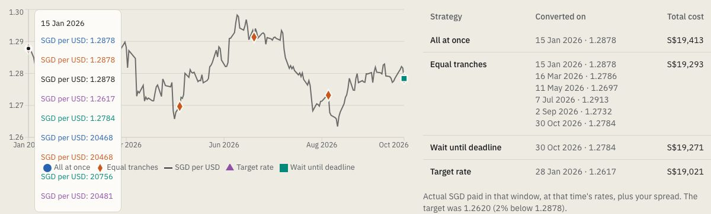 | 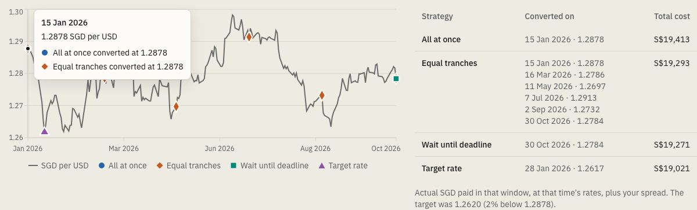 |

## B3. Highlighting dropped the text contrast

**Before:** the other rows went to 40% opacity, which gave text 2.5:1 (1.9:1 for muted text).

**After:** only the marks fade (swatches, bars and markers to 30%). The other rows' text turns `--muted`, which is 5.7:1 or more on every surface. This applies to the glance panel, the comparison table (both layouts) and the range chart. DESIGN.md is updated.

| Before                         | After                         |
| ------------------------------ | ----------------------------- |
| 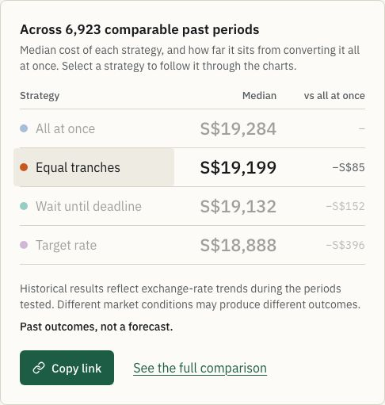 | 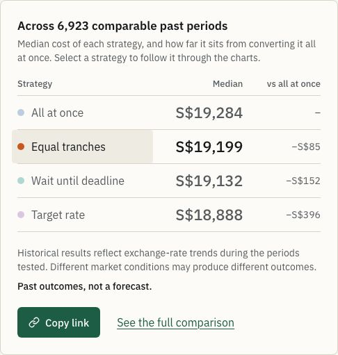 |

## B4. Smaller accessibility fixes

- **Month buttons:** they now wrap. Before, the page scrolled sideways at 320–375px and at 375px with 24px text; the "before" build was 379px wide at 375. Fixing it also exposed two 2px overflows at 320px, which are fixed too:
  - the amount sentence now wraps;
  - the conversions table breaks after the "·".
- **Date field focus:** with the calendar button focused, the field matches only `:focus-within`, so its ring vanished, which was most visible in dark mode. Date fields now show the ring whenever focus is inside them.
- **Hedging's range rows:** they were tabbable `role="button"` rows that did nothing. They're now plain rows; hover still previews them.
- **Results announced:** new results are announced politely: "Results updated for USD 15,000." on the planner, "Hedge results updated for 15,000 USD." on Hedging.
- **Skip link:** "Skip to content" is the first Tab stop and moves focus to `<main>`.
- **"More detail" toggles:** each now names its strategy for screen readers ("More detail: Equal tranches").
- **Edit bar:** the phone's Edit bar comes first in the tab order after the question, instead of last on the page.
- **Period chart labels:** the x-axis labels sit 8px lower, so they no longer touch the lowest rate label.
- **Tap targets:** "Back to the planner" is 44px tall. The inline "planner" link in the Hedging intro has a 44px-tall tap area without changing the line height.
- **Landscape phones:** below 480px of height (844×390), the summary bar stays hidden, leaving the timeline its room.

| Before                               | After                               |
| ------------------------------------ | ----------------------------------- |
| 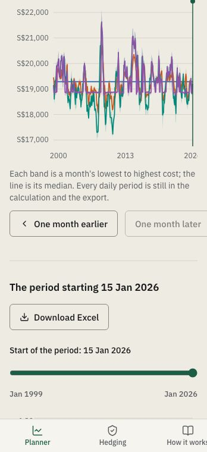 | 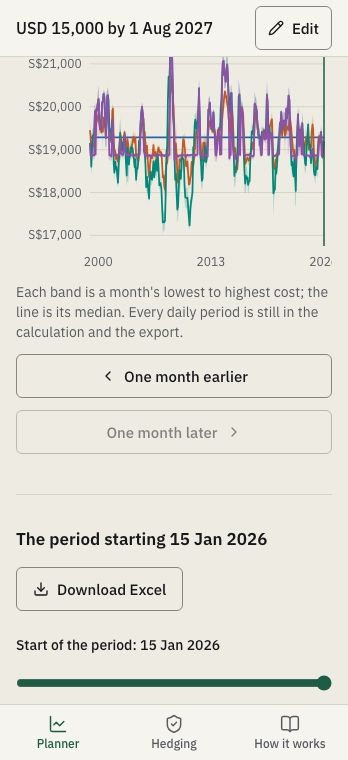 |
| 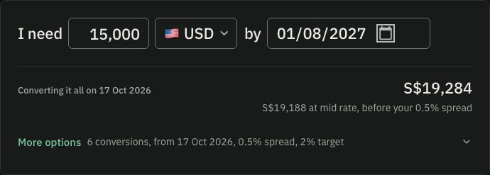   | 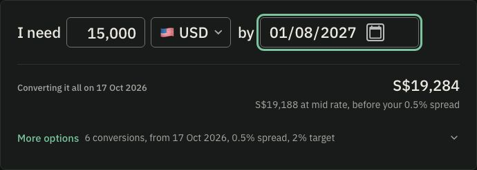   |
| 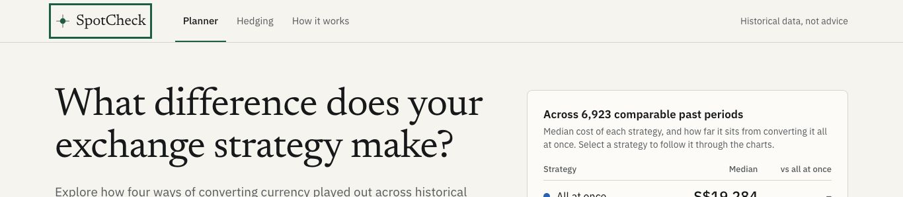         | 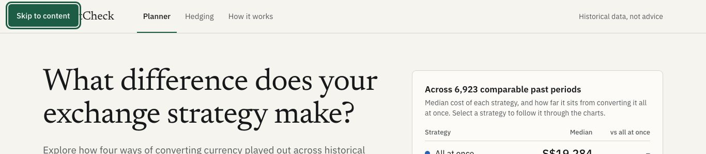         |
| 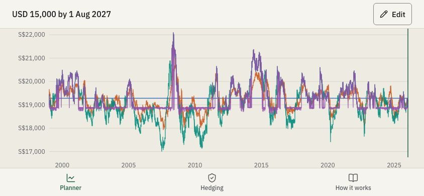 | 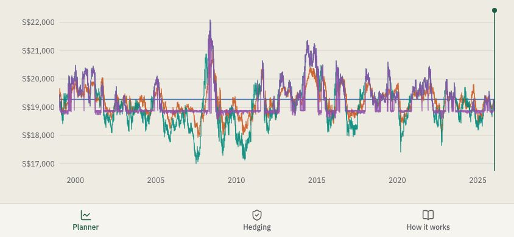 |

## B5. Performance

All figures are at 375px with 4x CPU, 3 runs each.

| Measure                                              | Before                                  | After                                                         |
| ---------------------------------------------------- | --------------------------------------- | ------------------------------------------------------------- |
| `/advanced` initial JavaScript (scripts in the HTML) | 1,027 KB (310 KB gz), Recharts included | **638 KB (196 KB gz)**; Recharts (108 KB gz) loads just after |
| `/advanced` long tasks over 50 ms / longest / TBT    | 3–4 / 199–208 ms / 218–240 ms           | 3 / 206–211 ms / 199–202 ms                                   |
| `/` long tasks over 200 ms                           | 0, 0, 0                                 | 0, 0, 0                                                       |
| `/` longest task / TBT                               | 143–174 ms / 135–162 ms                 | 128–130 ms / 121–123 ms                                       |
| Typing "250000": results after the last key          | 405–409 ms, 0 long tasks                | 406–413 ms, 0 long tasks                                      |
| Currency picker, per selection                       | +318 DOM nodes, +42 listeners           | **0, 0**                                                      |
| Lighthouse mobile performance, `/advanced`           | 92 (LCP 3.3 s, TBT 100 ms)              | **96** (LCP 2.8 s, TBT 50 ms)                                 |

**Recharts on `/advanced`:** the option panel, the only part of the page that draws with Recharts, loads lazily. A placeholder of its measured height (1,088 / 864 / 953 / 888 px by breakpoint) holds its space, and CLS is still 0.

**Typing and re-renders:** the testers measured 3.5 s on the build before PR A. PR A's change already gives this result: fields commit only when typing pauses, so each keystroke re-renders the form alone, never the charts. This build matches it, with no long tasks while typing. Adding memoisation or `useDeferredValue` on top would have nothing to save, so I left them out.

**`/` long tasks:** this machine sees no tasks over 200 ms on `/` before or after. The testers' 5–7 were on slower hardware.

**Currency picker leak:** Base UI 1.9.0, the latest, keeps closures from its list navigation that point at every closed list. The combobox now starts fresh after each close, so the old one can be freed, and focus returns to the currency button as before; keyboard and Esc are tested.

**Caching:** `_headers` sends `Cache-Control: public, max-age=31536000, immutable` for `/_next/static/*` (hashed names). Pages and data don't get it.

**Offline navigation:** not attempted. It's low priority, and graceful failure needs a service worker, which isn't simple.

## B6. Security hardening

- **CSP eval violation:** Zod v4's `allowsEval` probe set off a `script-src eval` violation on every Planner and Hedging load. It shows as a `securitypolicyviolation` event, not a console message. `z.config({ jitless: true })` in both modules that import Zod stops it, and `'unsafe-eval'` was not added.
  - **Local server:** `scripts/serve-out.ts` now sends the headers from `_headers` (parsed by `scripts/headers.ts`), so the tests run under the production CSP.
- **Actions pinned by SHA:** `actions/checkout@3d3c42e…` (v7.0.1) and `actions/setup-node@949feb2…` (v7.1.0), the same commits the `v7` tags point to today. Dependabot's existing `github-actions` updates keep the pins current.
- **fetch-data token:** checkout runs with `persist-credentials: false`. The token is given only to the commit step, as `GITHUB_TOKEN`, and used in the push URL.
- **`--ignore-scripts`:** both workflows run `npm ci --ignore-scripts`. The only install script in the tree is `unrs-resolver`'s, which only downloads a native binary if the optional platform package is missing. CI's lint passes without it.
- **Shipped files:** `out/` no longer contains the raw `compute.worker.*.ts` or the empty `.map`. A `postbuild` step (`scripts/clean-out.ts`) removes them. The worker itself runs from Turbopack's own bundled chunk; I checked on production that this is the file it loads.

## Checks

- `npm run check`: types, lint, Prettier, 406 unit tests and data validation.
- Playwright: 366 passed and 34 skipped (phone-only, keyboard-only or mouse-only) across mobile, desktop, de-DE/Berlin and en-US/Los Angeles.
- Against the `before` build: every applicable test in `e2e/hardening.spec.ts` fails (38 failed, 4 skipped).
- axe (WCAG 2.0–2.2 A/AA): 0 violations on `/`, `/advanced`, `/how-it-works` and the 404 page, at 375 and 1366, in light and dark. No chart focus stops, no `role="application"`, no assertive live regions, no sideways scroll.
- Parity with production: every planner figure is identical for USD, JPY, EUR and both BRL plans. Hedging's comparison table is identical, and so are 21 other Hedging values.
- Lighthouse (mobile, 4 runs each):

  | Page         | Performance | Accessibility, best practices, SEO | CLS |
  | ------------ | ----------- | ---------------------------------- | --- |
  | Planner      | 96          | 100                                | 0   |
  | Hedging      | 96 (was 92) | 100                                | 0   |
  | How it works | 97          | 100                                | 0   |
