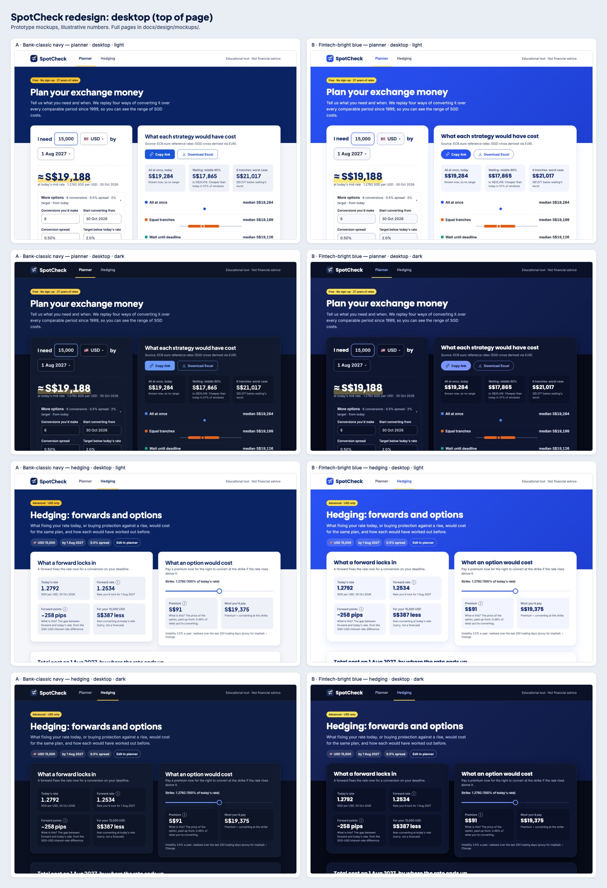
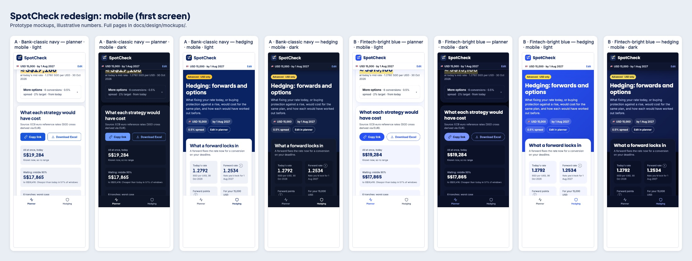

# SpotCheck redesign proposal

**Status:** proposal for review (Step 1). Nothing in the app has changed yet. Mockups come from a throwaway static prototype with illustrative numbers taken from the current app (USD 15,000 by 1 Aug 2027).

**Scope of the redesign:** UI and presentation only. `engine/`, the data pipeline, every number shown, the advisory-wording rules, the disclaimer, the source labels and the attribution stay exactly as they are.

## Two directions

|           | **A · Bank-classic navy** (recommended)                                    | **B · Fintech-bright blue**                                                            |
| --------- | -------------------------------------------------------------------------- | -------------------------------------------------------------------------------------- |
| Feel      | Calm, institutional, "a bank's converter page"                             | Energetic, app-like, "a money-transfer startup"                                        |
| Hero band | Deep navy, white type                                                      | Bright blue gradient, white type                                                       |
| Headings  | Plus Jakarta Sans 800/700                                                  | Poppins 700/600                                                                        |
| Shape     | 16px cards, 10px inputs and buttons                                        | 24px cards, 14px inputs, pill buttons                                                  |
| Yellow    | Small accents: eyebrow pill, highlight under the S$ figure, active-tab bar | Same roles, slightly brighter yellow                                                   |
| Risk      | Can feel plain if spacing is cramped                                       | Bright blue band competes with the results; pill buttons read more "promo" than "tool" |

**Recommendation: A.** SpotCheck asks students to trust historical numbers and reads like a bank's own tool, which suits navy. The calmer hero also leaves the results, the thing people came for, as the brightest element on the page. B's bright band pulls attention away from the numbers.

## Typography

Two families only, self-hosted through `next/font` (downloaded at build time and served from `/_next/static/media`, so `font-src 'self'` still holds and there are no runtime third-party requests). Geist is removed.

| Role                     | Family / weight | Size / line height (desktop) | Mobile  |
| ------------------------ | --------------- | ---------------------------- | ------- |
| Display (hero S$ figure) | Jakarta 800     | 44 / 52                      | 36 / 44 |
| H1 (page title)          | Jakarta 800     | 40 / 48                      | 30 / 36 |
| H2 (card title)          | Jakarta 700     | 24 / 32                      | 22 / 28 |
| H3 / tile value          | Jakarta 700     | 18–24 / 24–32                | same    |
| Body                     | Inter 400       | 16 / 24                      | 16 / 24 |
| UI labels, buttons       | Inter 600       | 15–16 / 24                   | same    |
| Small / helper           | Inter 400–500   | 14 / 20                      | same    |
| Caption / axis           | Inter 500       | 12 / 16                      | same    |

Weights shipped: Jakarta 700, 800; Inter 400, 500, 600 (five files). All numbers, rates and money use `font-variant-numeric: tabular-nums`.

## Colour

Tokens are roles, defined as CSS variables on `:root` with a dark set under `prefers-color-scheme: dark`. Dark mode uses its own steps chosen for the dark surface, not an inversion.

### Direction A tokens

| Token          | Light     | Dark      | Used for                               |
| -------------- | --------- | --------- | -------------------------------------- |
| `bg`           | `#F4F6FA` | `#0A1020` | Page background                        |
| `surface`      | `#FFFFFF` | `#111A2E` | Cards                                  |
| `sunken`       | `#EEF2F8` | `#0D1526` | Stat tiles, inset areas                |
| `border`       | `#D9E0EC` | `#25314B` | Card borders, dividers                 |
| `input-border` | `#7C8AA6` | `#5A6886` | Input and control outlines (≥3:1)      |
| `text`         | `#0B1B3F` | `#E9EEF8` | Body text                              |
| `muted`        | `#4B5875` | `#A6B1C8` | Secondary text                         |
| `navy`         | `#0A2463` | `#0F1E45` | Hero band, footer, headings (light)    |
| `blue`         | `#1A56DB` | `#6B9BFF` | Primary buttons, links, focus, sliders |
| `yellow`       | `#FFC52B` | `#FFD24D` | Highlights only, never text            |

Direction B uses the same roles with `blue #2952F5 / #7C97FF`, `navy #132A6B / #16245A`, a white page background, and `yellow #FFE14A / #FFE45C` (full values in the prototype).

### WCAG contrast (computed, not estimated)

Every text pair passes AA (≥4.5:1); focus rings, input borders and slider fills pass the 3:1 non-text rule.

#### Direction A

| Pair                                  | Light: colours         | Light ratio   | Dark: colours          | Dark ratio    |
| ------------------------------------- | ---------------------- | ------------- | ---------------------- | ------------- |
| Body text on page                     | `#0B1B3F` on `#F4F6FA` | 15.62:1 AA    | `#E9EEF8` on `#0A1020` | 16.29:1 AA    |
| Body text on card                     | `#0B1B3F` on `#FFFFFF` | 16.90:1 AA    | `#E9EEF8` on `#111A2E` | 14.90:1 AA    |
| Muted text on card                    | `#4B5875` on `#FFFFFF` | 7.11:1 AA     | `#A6B1C8` on `#111A2E` | 8.05:1 AA     |
| Muted text on page                    | `#4B5875` on `#F4F6FA` | 6.58:1 AA     | `#A6B1C8` on `#0A1020` | 8.80:1 AA     |
| Link / interactive text on card       | `#1A56DB` on `#FFFFFF` | 6.18:1 AA     | `#8AB0FF` on `#111A2E` | 8.04:1 AA     |
| Primary button label (on blue)        | `#FFFFFF` on `#1A56DB` | 6.18:1 AA     | `#06102A` on `#6B9BFF` | 6.96:1 AA     |
| Primary button hover label            | `#FFFFFF` on `#1546B3` | 8.21:1 AA     | `#06102A` on `#8AB0FF` | 8.73:1 AA     |
| Secondary button label (blue on card) | `#1A56DB` on `#FFFFFF` | 6.18:1 AA     | `#6B9BFF` on `#111A2E` | 6.41:1 AA     |
| Nav text on navy                      | `#FFFFFF` on `#0A2463` | 14.53:1 AA    | `#FFFFFF` on `#0F1E45` | 16.25:1 AA    |
| Nav muted text on navy                | `#C9D4EE` on `#0A2463` | 9.78:1 AA     | `#B9C6E4` on `#0F1E45` | 9.49:1 AA     |
| Badge text on yellow                  | `#0B1B3F` on `#FFC52B` | 10.68:1 AA    | `#0B1B3F` on `#FFD24D` | 11.73:1 AA    |
| Focus ring vs card (non-text)         | `#1A56DB` on `#FFFFFF` | 6.18:1 AA     | `#8AB0FF` on `#111A2E` | 8.04:1 AA     |
| Input border vs card (non-text)       | `#D9E0EC` on `#FFFFFF` | 1.33:1 (info) | `#25314B` on `#111A2E` | 1.34:1 (info) |
| Error text on card                    | `#B42318` on `#FFFFFF` | 6.57:1 AA     | `#FF8A80` on `#111A2E` | 7.60:1 AA     |

#### Direction B

| Pair                                  | Light: colours         | Light ratio   | Dark: colours          | Dark ratio    |
| ------------------------------------- | ---------------------- | ------------- | ---------------------- | ------------- |
| Body text on page                     | `#101828` on `#FFFFFF` | 17.75:1 AA    | `#EEF2FF` on `#070B18` | 17.55:1 AA    |
| Body text on card                     | `#101828` on `#FFFFFF` | 17.75:1 AA    | `#EEF2FF` on `#0F1630` | 15.95:1 AA    |
| Muted text on card                    | `#475467` on `#FFFFFF` | 7.69:1 AA     | `#A8B2D1` on `#0F1630` | 8.45:1 AA     |
| Muted text on page                    | `#475467` on `#FFFFFF` | 7.69:1 AA     | `#A8B2D1` on `#070B18` | 9.30:1 AA     |
| Link / interactive text on card       | `#2952F5` on `#FFFFFF` | 5.80:1 AA     | `#9AAEFF` on `#0F1630` | 8.38:1 AA     |
| Primary button label (on blue)        | `#FFFFFF` on `#2952F5` | 5.80:1 AA     | `#070B18` on `#7C97FF` | 7.22:1 AA     |
| Primary button hover label            | `#FFFFFF` on `#1F3FD1` | 7.81:1 AA     | `#070B18` on `#9AAEFF` | 9.23:1 AA     |
| Secondary button label (blue on card) | `#2952F5` on `#FFFFFF` | 5.80:1 AA     | `#7C97FF` on `#0F1630` | 6.56:1 AA     |
| Nav text on navy                      | `#FFFFFF` on `#132A6B` | 13.37:1 AA    | `#FFFFFF` on `#16245A` | 14.64:1 AA    |
| Nav muted text on navy                | `#CFDAFA` on `#132A6B` | 9.59:1 AA     | `#C4CFF5` on `#16245A` | 9.48:1 AA     |
| Badge text on yellow                  | `#101828` on `#FFE14A` | 13.62:1 AA    | `#101828` on `#FFE45C` | 13.95:1 AA    |
| Focus ring vs card (non-text)         | `#2952F5` on `#FFFFFF` | 5.80:1 AA     | `#9AAEFF` on `#0F1630` | 8.38:1 AA     |
| Input border vs card (non-text)       | `#E1E6F5` on `#FFFFFF` | 1.25:1 (info) | `#232D52` on `#0F1630` | 1.33:1 (info) |
| Error text on card                    | `#B42318` on `#FFFFFF` | 6.57:1 AA     | `#FF8A80` on `#0F1630` | 7.81:1 AA     |

#### Non-text and hero checks

| Direction / mode | Element                        | Colours                            | Ratio                   |
| ---------------- | ------------------------------ | ---------------------------------- | ----------------------- |
| A light          | Input border vs card           | `#7C8AA6` on `#FFFFFF`             | 3.48:1 pass             |
| A dark           | Input border vs card           | `#5A6886` on `#111A2E`             | 3.10:1 pass             |
| B light          | Input border vs input          | `#8090B5` on `#F7F9FF`             | 3.03:1 pass             |
| B dark           | Input border vs input          | `#56628C` on `#0B1126`             | 3.14:1 pass             |
| A light          | Hero heading / body on navy    | `#FFFFFF` / `#C9D4EE` on `#0A2463` | 14.53 / 9.78:1 pass     |
| A dark           | Hero body on band              | `#B9C6E4` on `#0F1E45`             | 9.49:1 pass             |
| B light          | Hero text on blue band         | `#FFFFFF` on `#2952F5`             | 5.80:1 pass             |
| B dark           | Hero body on band              | `#C4CFF5` on `#16245A`             | 9.48:1 pass             |
| A light          | Slider fill vs track           | `#1A56DB` on `#E6EBF3`             | 5.16:1 pass             |
| A light          | Yellow active-tab bar vs white | `#FFC52B` on `#FFFFFF`             | 1.58:1, decorative only |

The yellow tab bar is decoration: the active tab is also marked by navy bold text and `aria-current="page"`, so it never relies on the yellow.

### Chart series

One entity, one colour, on both pages: all at once / forward = series 1, equal tranches / option = series 2, wait until deadline / unhedged = series 3, target rate = series 4. Legends, direct labels and marker shapes stay, so colour is never the only signal.

| Slot       | Light                    | Dark      |
| ---------- | ------------------------ | --------- |
| 1 (blue)   | `#1A56DB` (B: `#2952F5`) | `#4A86F0` |
| 2 (orange) | `#E8590C`                | `#E5641F` |
| 3 (teal)   | `#0F9D8A`                | `#12A388` |
| 4 (violet) | `#7A4CC2`                | `#8F6EE6` |

Checked with the data-viz palette validator: lightness band, chroma, colour-blind separation (worst adjacent ΔE 14.8 light, 13.5 dark; target ≥8), normal-vision floor and ≥3:1 against the card surface all pass in both modes. Yellow is deliberately not a series colour, so it stays a highlight.

## Spacing, radius, elevation

- **8px grid:** 8, 16, 24, 32, 40, 48, 64, 96. 4px only for icon-to-label gaps.
- **Layout:** max width 1200px; 32px gutters on desktop, 16px on mobile; 24px between cards.
- **Radius (A):** inputs and buttons 10px, cards 16px, pills 999px. (B: 14px / 24px / pill buttons.)
- **Elevation:** one card shadow (`0 1px 2px` + `0 8px 24px`, low opacity); no stacked shadows.
- **Tap targets:** every control at least 44 × 44px; the main converter fields are 56px tall.

## Components

| Component                      | Behaviour                                                                                                                                                                                                                                                                                         |
| ------------------------------ | ------------------------------------------------------------------------------------------------------------------------------------------------------------------------------------------------------------------------------------------------------------------------------------------------- |
| **Top nav**                    | Wordmark (original exchange-arrows icon + "SpotCheck") left, "Planner" / "Hedging" tabs. Sticky. On phones the tabs move to a fixed bottom tab bar (64px, thumb-reachable) and the top bar keeps the wordmark.                                                                                    |
| **Hero band**                  | Navy band with H1 and one-line explanation; the first card overlaps it. Static HTML, so it paints before JavaScript (keeps LCP fast).                                                                                                                                                             |
| **Converter card**             | Reads as a sentence: "I need [amount] [currency ▾] by [date]". Under it, the large "≈ S$X at today's mid rate" with rate and date in small type.                                                                                                                                                  |
| **Currency picker**            | Combobox searchable by code, currency name and country ("Japan" → JPY, "Korea" → KRW, "Germany" → EUR). Popular destinations pinned on top: USD, GBP, EUR, AUD, CAD, KRW, JPY. Flags shown. Keyboard: arrows, Enter, Esc. Country names live in a new UI-only lookup in `lib/`, not in `engine/`. |
| **More options**               | Collapsed disclosure showing current values in one line ("6 conversions · 0.5% spread · 2% target · from today"); opens to conversions, start date, spread, target. Collapsed by default on phones; open on desktop if any value differs from the default.                                        |
| **Sticky summary bar** (phone) | "🇺🇸 USD 15,000 · by 1 Aug 2027 · Edit" under the top bar once the converter scrolls away; "Edit" scrolls back to the converter.                                                                                                                                                                   |
| **Results header**             | Title, source label, and two actions in a fixed place: **Copy link** (primary) and **Download Excel** (secondary).                                                                                                                                                                                |
| **Stat tiles**                 | Three numbers in plain words (all at once today; waiting's middle 90%; tranches' worst case). Same values the summary already reports.                                                                                                                                                            |
| **Range chart**                | Existing chart restyled: series colours, 12px axis labels, tick decimals from spacing (existing helper). Skeleton of the same height while loading.                                                                                                                                               |
| **Summary**                    | Existing generated sentences, with a yellow left rule.                                                                                                                                                                                                                                            |
| **One-window chart**           | Existing slider and chart restyled; legend under the chart.                                                                                                                                                                                                                                       |
| **Methodology**                | Existing accordion, restyled.                                                                                                                                                                                                                                                                     |
| **Hedging cards**              | Plain-English titles: "What a forward locks in", "What an option would cost", "How sensitive is the option?", "How each hedge would have worked out".                                                                                                                                             |
| **Help tips**                  | An "i" button with a short "What is this?" for forward points, premium, delta, gamma, vega and theta. Keyboard-focusable, opens on tap/focus, `aria-describedby`.                                                                                                                                 |
| **Buttons**                    | One primary (solid blue) and one secondary (blue outline). Visible 3px focus ring on everything focusable.                                                                                                                                                                                        |
| **Skeletons**                  | Fixed-height placeholders for results and charts, so nothing shifts when data arrives (keeps CLS at 0).                                                                                                                                                                                           |
| **Footer**                     | Navy (A) with the disclaimer and attribution, unchanged in wording.                                                                                                                                                                                                                               |
| **Favicon / touch icon**       | New mark from the wordmark's icon, at 32px and 180px.                                                                                                                                                                                                                                             |

## Decisions to confirm

1. **Direction:** A or B.
2. **Phone navigation:** bottom tab bar (proposed, easiest for thumbs) or keep the tabs in the sticky top bar.
3. **"Download Excel" in the results header:** it exports the window currently selected in "Look at one window" (most recent by default), as today. The button will say so in its accessible name and a one-line hint.
4. **New copy:** hero line "Plan your exchange money", eyebrow "Free · No sign-up · 27 years of rates", and the hedging card titles above. All are descriptive, never advisory, and the wording test will cover them.
5. **Cloudflare preview URL:** a per-branch preview needs Cloudflare Pages connected to the new public repo. If it isn't connected yet, the PR will include everything else and note that the preview is pending.

## Mockup files

Full pages in `docs/design/mockups/` (desktop 1280px wide, phone 390px; plus `-screen` files showing a phone's first screen with the sticky bars in place):

|                  | A light                       | A dark                       | B light                       | B dark                       |
| ---------------- | ----------------------------- | ---------------------------- | ----------------------------- | ---------------------------- |
| Planner, desktop | `A-planner-desktop-light.jpg` | `A-planner-desktop-dark.jpg` | `B-planner-desktop-light.jpg` | `B-planner-desktop-dark.jpg` |
| Planner, phone   | `A-planner-mobile-light.jpg`  | `A-planner-mobile-dark.jpg`  | `B-planner-mobile-light.jpg`  | `B-planner-mobile-dark.jpg`  |
| Hedging, desktop | `A-hedging-desktop-light.jpg` | `A-hedging-desktop-dark.jpg` | `B-hedging-desktop-light.jpg` | `B-hedging-desktop-dark.jpg` |
| Hedging, phone   | `A-hedging-mobile-light.jpg`  | `A-hedging-mobile-dark.jpg`  | `B-hedging-mobile-light.jpg`  | `B-hedging-mobile-dark.jpg`  |
